## 推定時間：15分

## この Lab のねらい

これから 2 日間、Azure という環境の上にネットワークとサーバーを作ります。

その最初の一歩として、**自分のアカウントでサインインし、多要素認証を登録します**。

ここでつまずくと先に進めません。全員がそろってから次に進みます。

---

## 事前に用意するもの

| | 内容 |
|---|---|
| アカウント | 講師から配付された ID とパスワード |
| スマートフォン | 多要素認証で使います |
| ブラウザ | Microsoft Edge または Google Chrome |

> スマートフォンを持っていない場合は、講師に申し出てください。別の方法を用意します。

---

## タスク 1 - 認証アプリを入れる（5分）

多要素認証には、スマートフォンのアプリを使います。

### 1-1　アプリを入れる

スマートフォンで、次のアプリを入れてください。

- iPhone: App Store で「**Microsoft Authenticator**」を検索し、`[入手]` を選ぶ
- Android: Google Play で「**Microsoft Authenticator**」を検索し、`[インストール]` を選ぶ

> すでに入っている場合は、そのまま使えます。

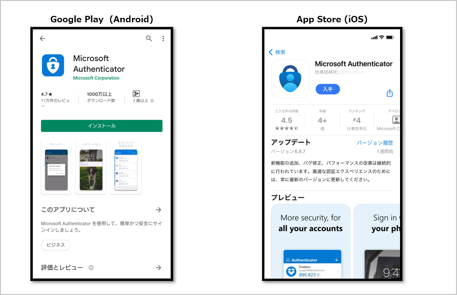

### 1-2　起動する

アプリを開きます。初回は次の順に画面が出ます。

1. 「Microsoft はお客様のプライバシーの保護に努めています」→ `[承諾する]`
2. 「Microsoft Authenticator の品質向上にご協力ください」→ `[続行]`
3. 「デジタル ライフを保護する」→ 右上の `[スキップ]`

「初めてのアカウントを追加しますか？」という画面が出たら、この画面のまま待ちます。

パソコン側の操作が終わるまで、この画面を開いたままにしておいてください。

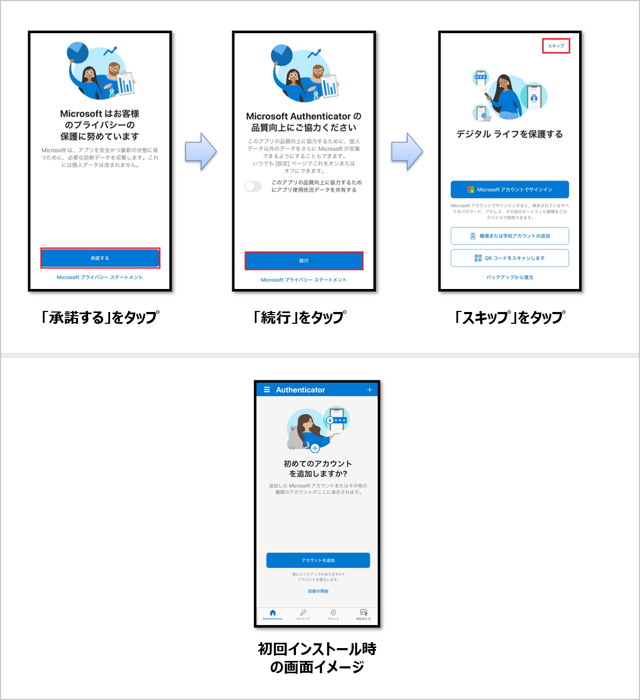

---

## タスク 2 - サインインする（5分）

### 2-1　ポータルを開く

パソコンのブラウザで、次のアドレスを開きます。

```
https://portal.azure.com
```

> 会社のアカウントなど、別のアカウントで自動的にサインインされてしまう場合は、
> ブラウザのシークレットウィンドウ（Edge では InPrivate ウィンドウ）で開いてください。

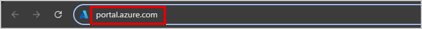

### 2-2　ID を入力する

「サインイン」の画面が出ます。配付された ID を入力し、`[次へ]` を選びます。

ID は次のような形式です。

```
TK000000@ctctedu.onmicrosoft.com
```

> **自分の番号を確認してください。**他の人の番号でサインインしないでください。

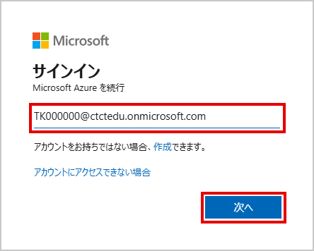

### 2-3　パスワードを入力する

「パスワードの入力」の画面が出ます。配付されたパスワードを入力し、`[サインイン]` を選びます。

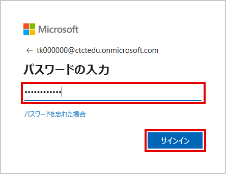

### 2-4　サインインの状態

「サインインの状態を維持しますか？」という画面が出ます。`[いいえ]` を選びます。

> サインインの状態は残しません。

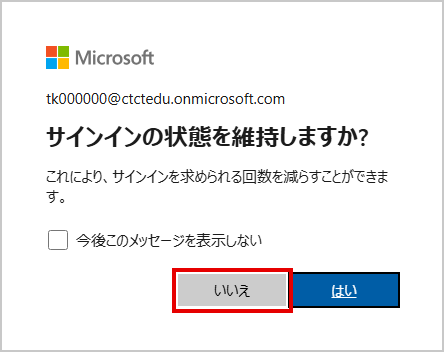

---

## タスク 3 - 多要素認証を登録する（5分）

### 3-1　QR コードを表示する

1. 「アカウントをセキュリティ保護しましょう」という画面が出ます。`[次へ]` を選びます
2. 「Microsoft Authenticator のインストール」という画面が出ます。アプリはタスク 1 で入れてあるので、そのまま `[次へ]` を選びます
3. 「QR コードをスキャンします」という画面が出ます。**ここではまだ `[次へ]` を選びません**

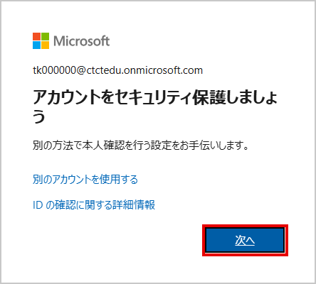

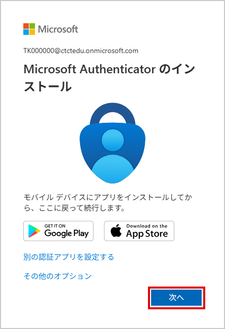

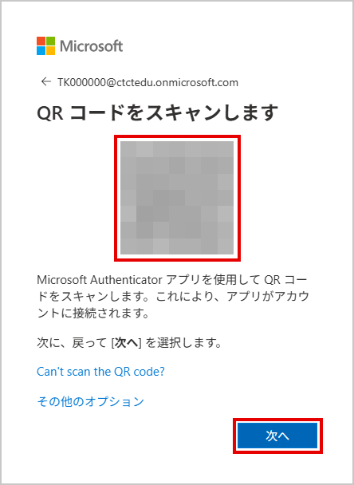

### 3-2　QR コードを読み取る

スマートフォンのアプリに戻ります。

1. 画面右下の QR コードのボタンを選びます
2. 「QR コードをスキャン」の画面になったら、カメラをパソコンの画面の QR コードに向けます

> カメラの利用を求められたら、許可してください。

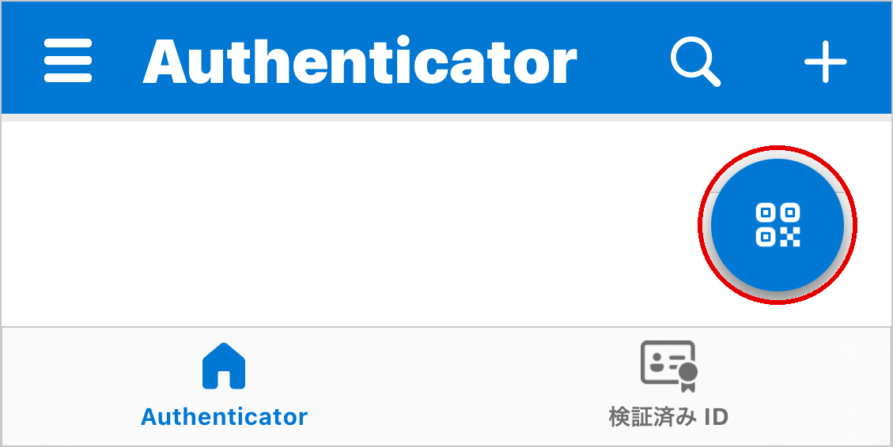

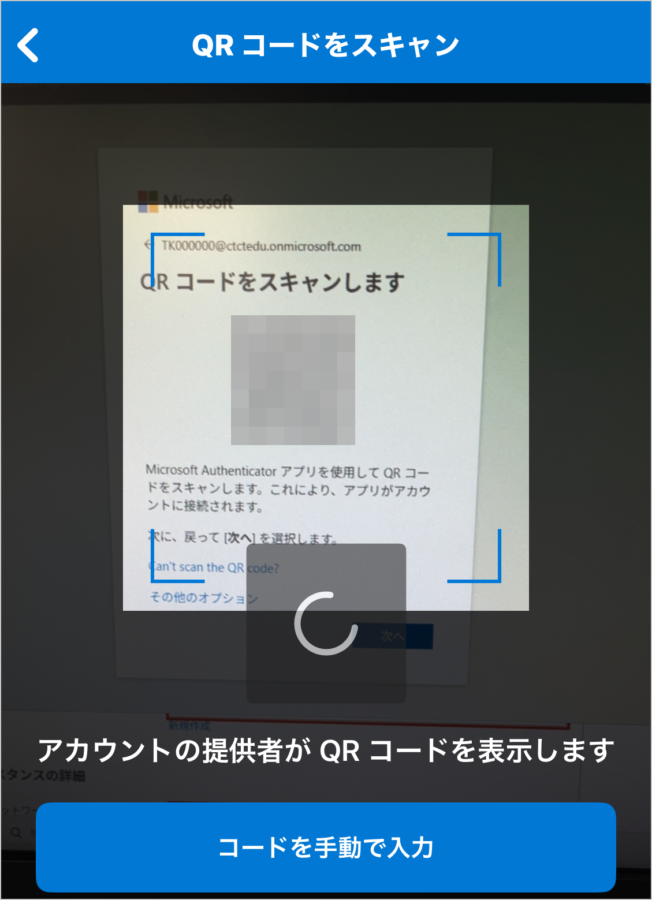

読み取ったら、パソコンの「QR コードをスキャンします」の画面で `[次へ]` を選びます。

### 3-3　番号を入力する

パソコンに「試してみましょう」という画面が出て、2 桁の数字が表示されます。

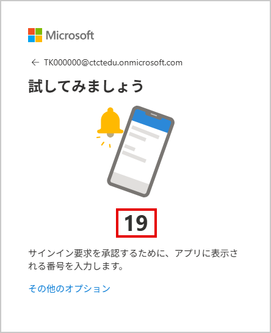

スマートフォンに「サインインしようとしていますか？」と表示されます。パソコンに表示された数字を入力し、`[はい]` を選びます。

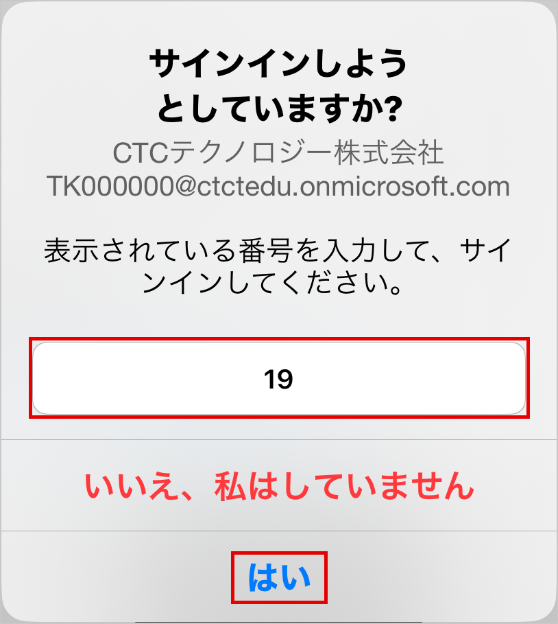

### 3-4　完了

パソコンに「Authenticator Added」という画面が出ます。`[完了]` を選びます。

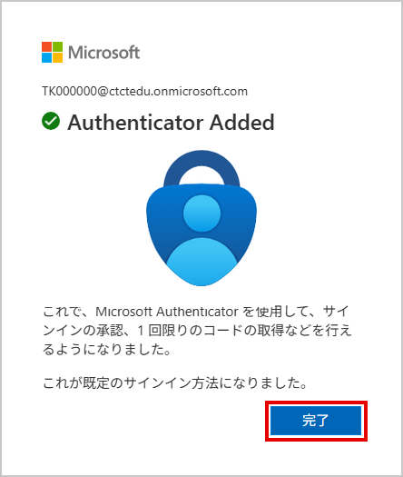

---

## 完了の確認

Azure ポータルの画面が表示されていれば完了です。

画面の上部に、次のものが見えます。

| 位置 | 内容 |
|---|---|
| 左上 | 「Microsoft Azure」 |
| 右上 | 自分の ID（TK で始まる ID） |

**右上の ID が、配付された ID と一致していることを確かめてください。**

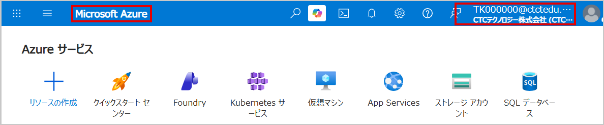

---

## 記録すること

ワークブックの「Day3　構築チェックリスト ①」に、次を記入します。

- Lab00 のチェック欄に印を付ける
- 自分の ID を書き留める

---

## うまくいかないとき

| 症状 | 確かめること |
|---|---|
| ID が違うと言われる | 綴りを確認。`@` 以降まで正確に入力する |
| パスワードが違うと言われる | 大文字と小文字を確認。数字の 0 と英字の O に注意 |
| 別のアカウントでサインインされる | シークレットウィンドウで開き直す |
| QR コードが読み取れない | 画面の明るさを上げる。カメラを近づけすぎない |
| 通知が届かない | アプリの通知が許可されているか確認 |
| 数字を入れる画面が出ない | アプリを一度閉じて開き直す |

> 5 分試して解決しない場合は、手を挙げて講師を呼んでください。
> ここで時間を使いすぎると、後の作業に影響します。

---

## 注意すること

- **配付された ID とパスワードは、他の人に教えないでください**
- 研修が終わったら、このアカウントは削除されます
- スマートフォンのアプリからも、研修後にアカウントを削除してください
