## 推定時間：40分

Lab03 で配置したサンプルチャットサイトは、まだ AI と会話できません。
このLabでは、Azure AI Foundry を作成してモデルをデプロイし、`config.js` に接続情報を書き込むことで、実際に AI と会話できる状態にします。

## タスク 1 - Azure AI Foundry リソースを作成する

1. Azure Portal 上部の検索バーに `AI Foundry` と入力し、検索候補の「サービス」欄から [Microsoft Foundry] を選択します。

    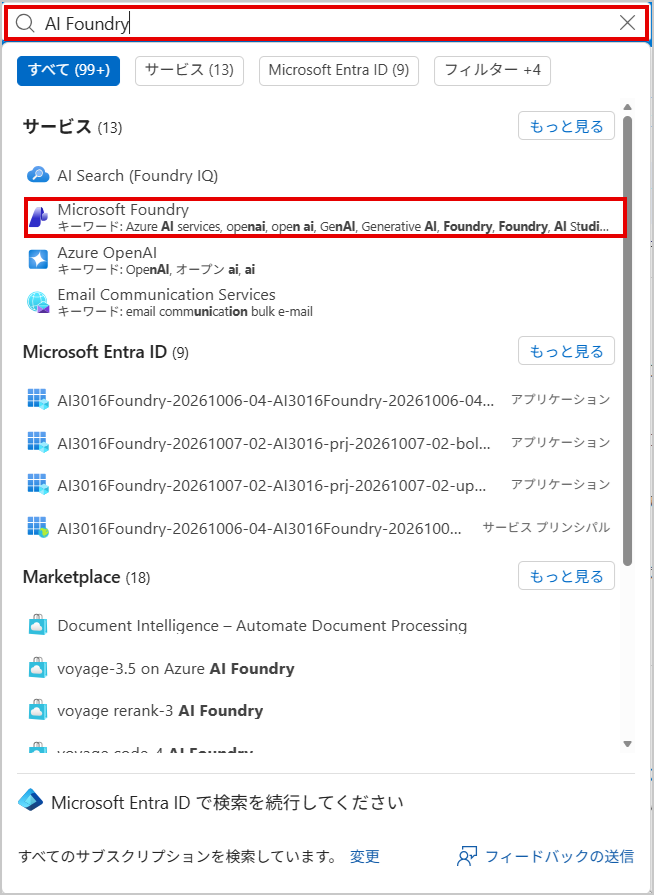

2. 「Microsoft Foundry」の概要画面が表示されたら、[リソースの作成] をクリックします。

    > 注：すでに他のリソースが作成済みの一覧画面が表示された場合は、画面左上の [＋ 作成] をクリックし、表示されるメニューから [新しい Microsoft Foundry の作成] を選択してください。

    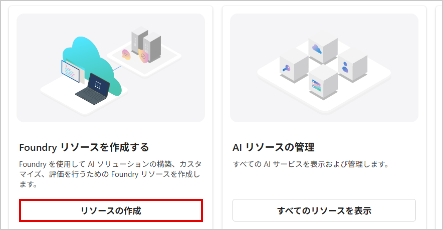

3. 「Foundry リソースを作成する」画面の [基本情報] タブで、以下を設定します。

    | 項目 | 値 |
    |---|---|
    | サブスクリプション | 講師が用意したサブスクリプション（画面例では「従量課金」） |
    | リソース グループ | rg-intern-YYMMDD-NN |
    | 名前 | aif-intern-YYMMDD-NN |
    | リージョン | (Asia Pacific) Japan East |

    > 注：「リソース グループ」を選択すると、「名前」欄に既定でリソース グループ名（`rg-intern-YYMMDD-NN`）がそのままコピーされます。これは自動入力であり、そのまま進めると他のリソース（VNet や VM）と紛らわしい名前になってしまいます。**必ず `aif-intern-YYMMDD-NN` に書き換えてください。**

    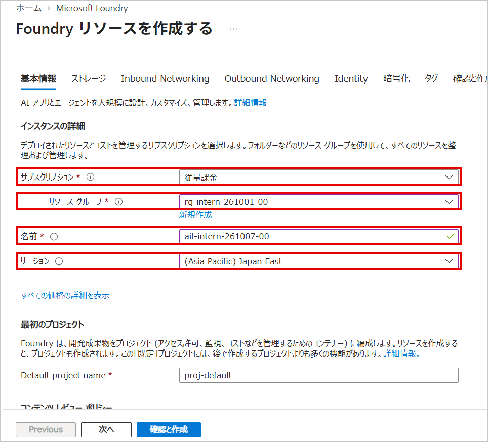

4. 「Default project name」は既定値（`proj-default`）のまま変更しません。

5. 「コンテンツ レビュー ポリシー」も既定のまま変更しません。

6. 画面左下の [確認と作成] をクリックします。

7. 内容を確認し、[作成] をクリックします。

    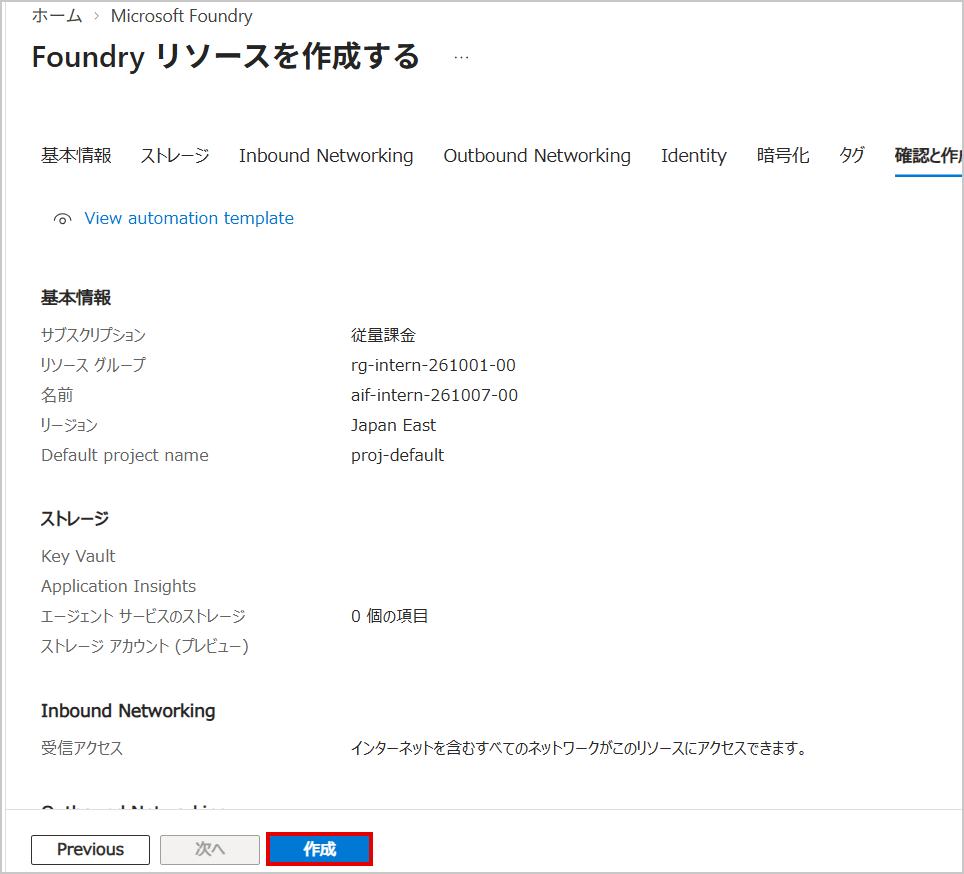

8. 「デプロイが完了しました」と表示されるまで待ちます（数分かかります）。

    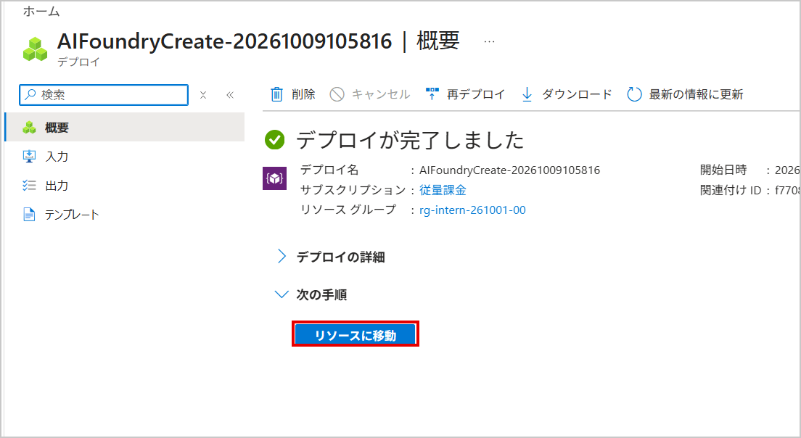

9. [リソースに移動] をクリックし、「概要」画面が表示されることを確認します。

    | 項目 | 値 |
    |---|---|
    | API の種類 | AIServices |
    | 場所 | japaneast |
    | 状態 | Succeeded |

    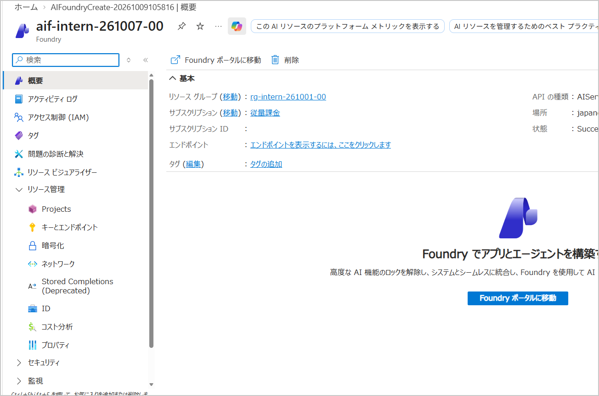

## タスク 2 - モデルをデプロイする

1. リソースの「概要」画面で、[Foundry ポータルに移動] をクリックします。

    > 注：別タブで Foundry ポータル（`ai.azure.com`）が開きます。Azure Portal のタブは、この後の手順で使うのでそのまま残しておいてください。

    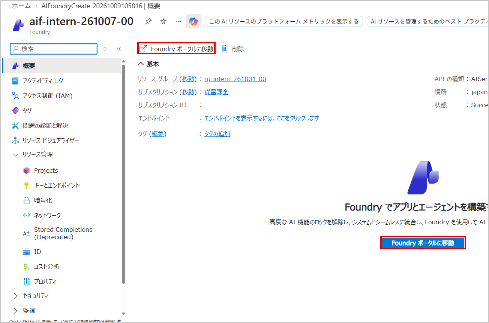

2. Foundry ポータルの「ようこそ、〇〇さん」画面で、左上の「モデルを使用する」カードにある [デプロイの表示] をクリックします。

    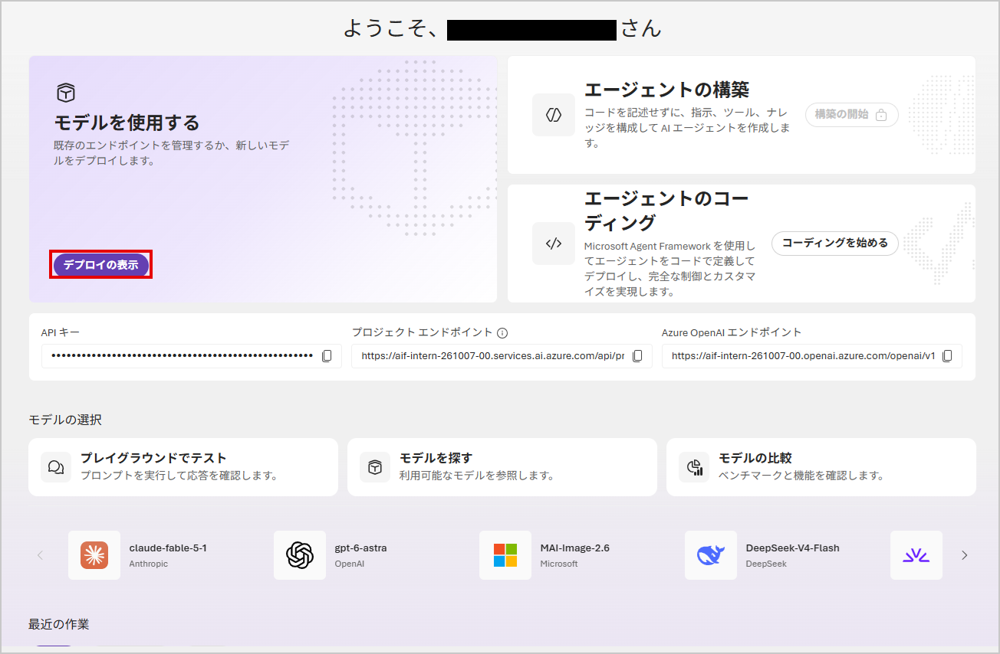

3. 「モデル」画面の [デプロイ] タブで、画面右上の [デプロイ] をクリックし、表示されるメニューから [基本モデルをデプロイする] を選択します。

    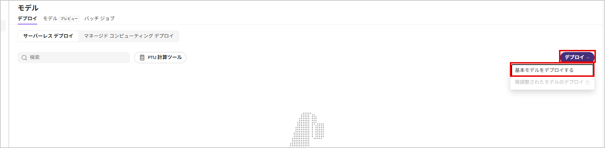

4. 「モデル」一覧の検索欄に `gpt-5.4-nano` と入力します。

    > 注：モデル名は「ドット区切り」です（`gpt-5-4-nano` ではなく `gpt-5.4-nano`）。**本研修では必ず `gpt-5.4-nano` を使用してください。** 似た名前の `gpt-5.4-mini` は容量が不足しており、デプロイに失敗します。

    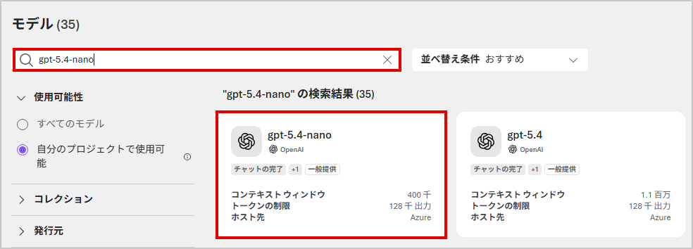

5. 検索結果から [gpt-5.4-nano] のカードを選択します。

6. モデルの詳細画面が表示されたら、右上の [デプロイ] をクリックし、表示されるメニューから **[カスタム設定]** を選択します。

    > 注：**[既定の設定] は選ばないでください。** [既定の設定] は、研修用サブスクリプションに残っている容量の半分を 1 人で使ってしまうため、後からデプロイする人が失敗します。

    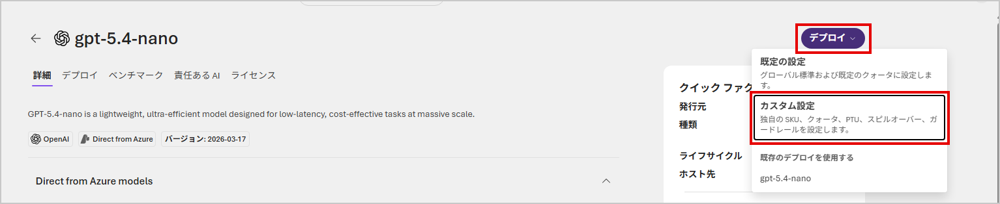

7. 「gpt-5.4-nano のデプロイ」パネルで、以下を設定します。

    | 項目 | 値 |
    |---|---|
    | デプロイ名 | gpt-5.4-nano（既定値のまま） |
    | デプロイの種類 | グローバル標準（既定値のまま） |
    | 1 分あたりのトークン数レート制限 | `1000` |

    > 注：「1 分あたりのトークン数レート制限」は、右側の入力欄に `1000`と入力します。スライダーは使いません。単位はトークンです（`100` と入れると 100 トークンになり、チャットがすぐに止まります）。
    > 注：デプロイ名は必ず `gpt-5.4-nano` にしてください。この後 `config.js` の設定値（`DEPLOYMENT`）と一致させる必要があります。画面例では、同じリソースに検証用のデプロイがあるため `gpt-5.4-nano-2` と表示されています。

    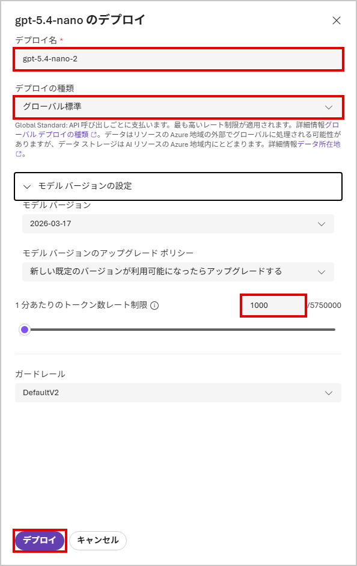

8. パネル下部の [デプロイ] をクリックします。

9. デプロイが完了すると、自動的に「プレイグラウンド」画面に切り替わります。「モデル: gpt-5.4-nano」と表示されていることを確認します。

    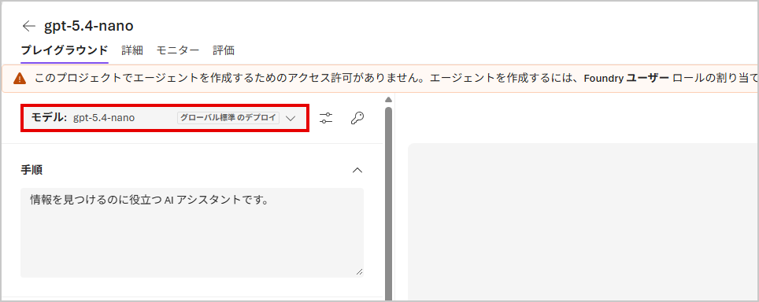

10. （任意）画面右側のチャット欄に「こんにちは」と入力して送信し、AI から応答が返ることを確認します。

    > 注：ここで確認できるのは Foundry ポータル上での動作です。自分のチャットサイトから使うには、タスク 3 でエンドポイントと API キーを取得し、`config.js` に書き込む必要があります。

    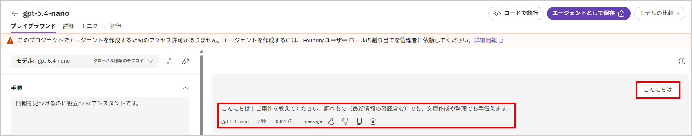

## タスク 3 - エンドポイントと API キーを取得して config.js を書き換える

このタスクでは、2 つの異なる画面から、それぞれ別の情報を取得し、取得した値をすぐに `config.js` へ書き込みます。エンドポイント（手順1〜5）、API キー（手順6〜10）の順に進め、最後にチャットサイトで動作を確認します（手順11〜13）。

1. Foundry ポータル左上の「Microsoft Foundry」をクリックし、ホーム画面（「ようこそ、〇〇さん」の画面）に戻ります。

2. 「Azure OpenAI エンドポイント」欄の コピー アイコンをクリックし、値をコピーします。

    > 注：似た項目に「プロジェクト エンドポイント」がありますが、こちらは使用しません。**必ず「Azure OpenAI エンドポイント」の値を使ってください。** コピーした値は `https://aif-intern-YYMMDD-NN.openai.azure.com/openai/v1` のような形式で、末尾に `/openai/v1` が付いています。この部分は後の手順で取り除きます。

    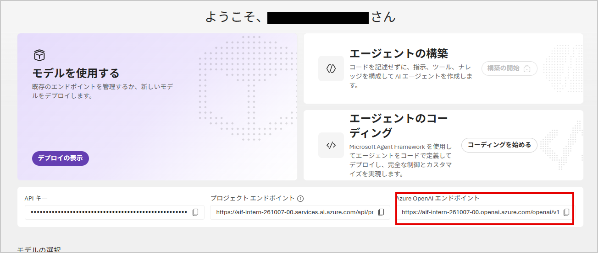

3. Lab02 で接続した PowerShell の SSH セッションで、以下のコマンドを実行し、コピーしたエンドポイントの末尾から `/openai/v1` を取り除いた値を変数に入れます。

    ```bash
    read -r RAW_ENDPOINT
    ```

    Enter キーを押すとカーソルだけの行になるので、手順2でコピーした「Azure OpenAI エンドポイント」の値を貼り付けて、再度 Enter キーを押します。

4. 続けて、以下のコマンドを実行し、末尾を取り除いた値を確認します。

    ```bash
    ENDPOINT="${RAW_ENDPOINT%/openai/v1}"
    echo "$ENDPOINT"
    ```

    表示された値が、末尾に余分な文字が付いていない `https://aif-intern-YYMMDD-NN.openai.azure.com` の形式になっていることを確認してください。

    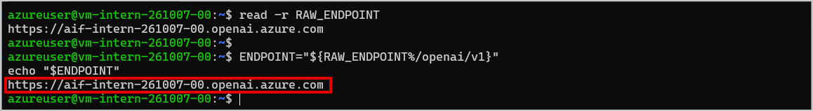

5. `config.js` の `ENDPOINT` を書き換えます。以下のコマンドは**一文字も書き換えずに**、そのまま貼り付けて実行します。

    ```bash
    sudo sed -i "s|^\( *ENDPOINT:\).*|\1 \"$ENDPOINT\",|" /var/www/html/config.js
    ```

    > 注：`$ENDPOINT` の部分には、手順4 で変数に入れた値が自動的に入ります。エンドポイントの URL を自分でコマンドに書き込む必要はありません。値を間違えた場合は、手順3 からやり直してこのコマンドをもう一度実行すれば上書きされます。

    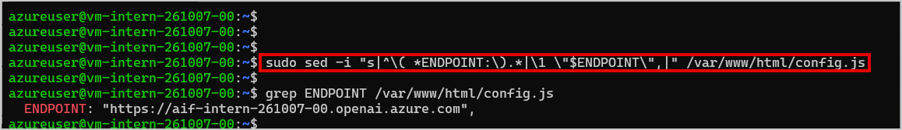

6. Azure Portal 側のタブに切り替えます（タスク2の手順1で開いたままにしていたタブです）。リソースの「概要」画面で、左側メニューの [リソース管理] を展開し、[キーとエンドポイント] をクリックします。

    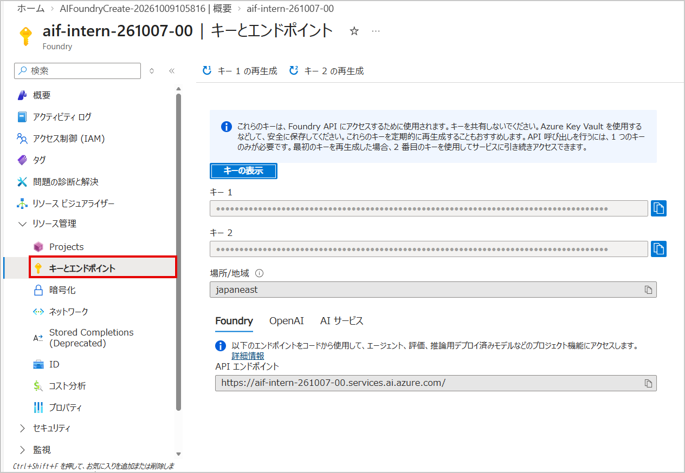

7. 「キー 1」の値を、コピー アイコンでコピーします。

    > 注：**ここで取得する「キー 1」が、チャットサイトで使う正しい API キーです。** Foundry ポータルのホーム画面にも「API キー」という項目がありますが、これは別の用途（プロジェクト単位）のキーであり、チャットサイトからの接続には使用できません。誤って使うと「API キーが正しくありません」（401 エラー）が発生します。

    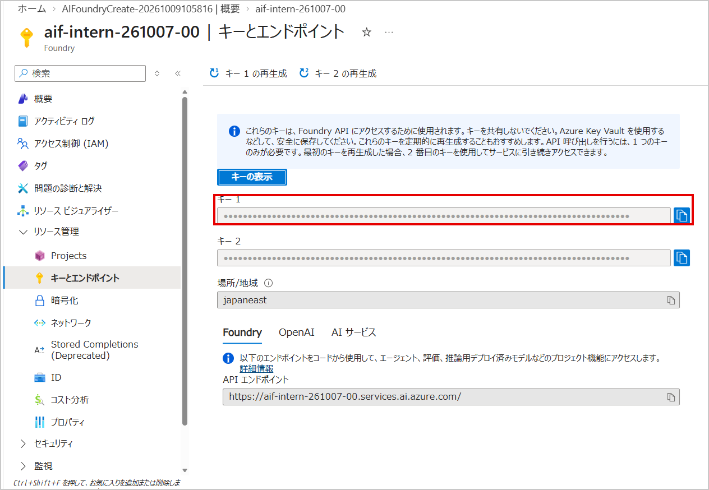

8. API キーを変数に入れます。

    ```bash
    read -r API_KEY
    ```

    Enter キーを押した後、手順7でコピーした「キー 1」の値を貼り付けて、再度 Enter キーを押します。

9. `config.js` の `API_KEY` を書き換えます。このコマンドも**一文字も書き換えずに**、そのまま貼り付けて実行します。

    ```bash
    sudo sed -i "s|^\( *API_KEY:\).*|\1 \"$API_KEY\",|" /var/www/html/config.js
    ```

    > 注：`$API_KEY` の部分には、手順8 で変数に入れたキーが自動的に入ります。

10. 書き換えた内容を確認します。

    ```bash
    grep -E "ENDPOINT|DEPLOYMENT|API_KEY" /var/www/html/config.js
    ```

    以下の3項目が表示されることを確認します。

    | 項目 | 値の例 |
    |---|---|
    | ENDPOINT | `https://aif-intern-YYMMDD-NN.openai.azure.com` |
    | DEPLOYMENT | `gpt-5.4-nano`（既定値のまま） |
    | API_KEY | （手順7でコピーした文字列） |

    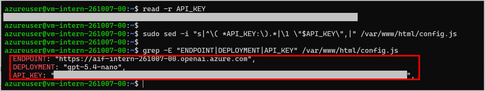

11. Web ブラウザで `http://<VMのパブリックIPアドレス>/` を開き、`Ctrl + F5`（スーパーリロード）で画面を更新します。

12. 入力欄の上の赤い案内が消え、「こんにちは。聞きたいことを入力してください。」という AI からの最初のメッセージが表示されることを確認します。

    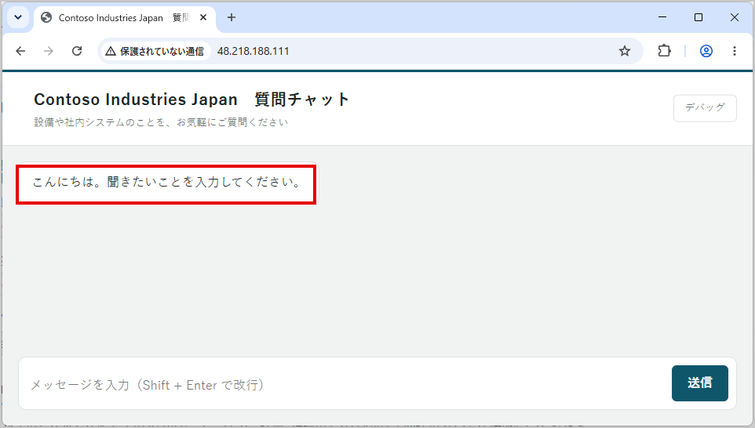

13. メッセージ入力欄に何か質問を入力し、送信します。AI から応答が返ってくれば、接続は成功です。

    > 注：応答に数秒かかることがあります。応答中は入力欄と送信ボタンが一時的に無効になります。

    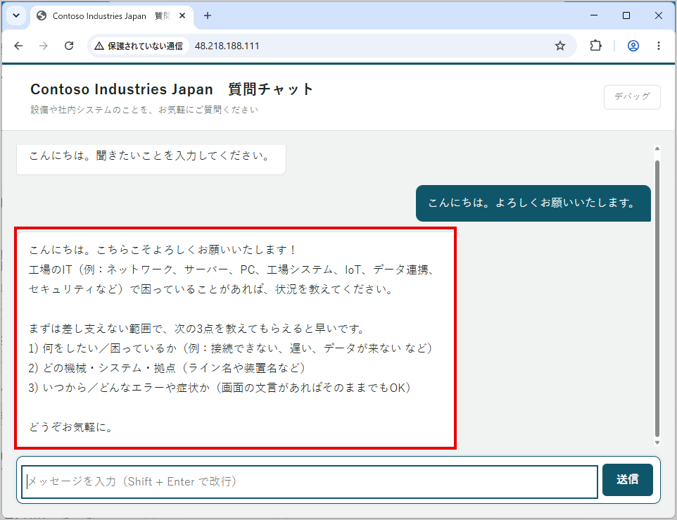

これで Lab04（タスク1〜3：AI Foundry リソースの作成、モデルのデプロイ、エンドポイント・API キーの取得と config.js の書き換え・動作確認）は完成です。

## うまく動かないとき

| 症状 | 確認すること |
|---|---|
| 「API キーが正しくありません」（401） | `API_KEY` に Foundry ポータルのホーム画面の「API キー」を使っていないか。Azure Portal の「キーとエンドポイント」画面の「キー 1」を使っているか確認してください |
| 「接続先が見つかりません」（404） | `ENDPOINT` の末尾に `/openai/v1` が残っていないか、`.openai.azure.com` の前のリソース名が正しいか |
| 「クォータが不足しています」と表示されデプロイできない | 検索したモデル名が `gpt-5.4-nano`（ドット区切り）になっているか。`gpt-5-4-mini` や `gpt-5.4-mini` は選択しないでください。[既定の設定] ではなく [カスタム設定] を選び、トークン数を `100000` にしているか。それでも失敗する場合は講師に伝えてください（ほかの人が [既定の設定] で容量を使い切っている可能性があります） |
| 画面が真っ白、または反応しない | `config.js` の記述にカンマの消し忘れなどがないか。`sudo cat /var/www/html/config.js` で内容を確認してください |

その他のエラーメッセージについては、[`sampleChatbotSite/README.md`](../sampleChatbotSite/README.md) のトラブルシュート表もあわせて確認してください。
